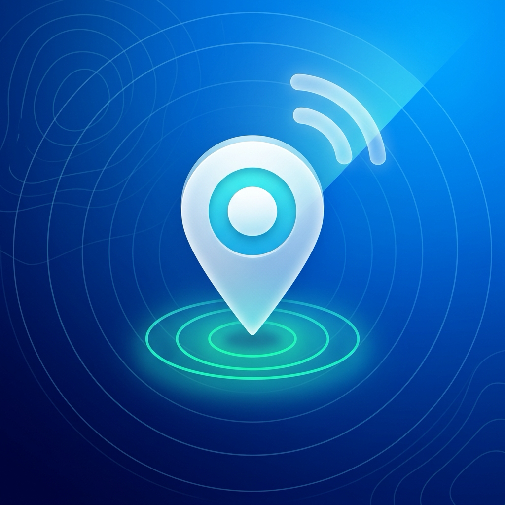
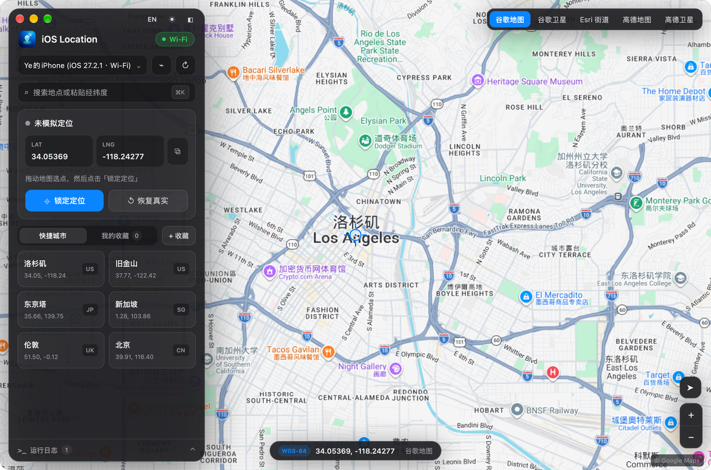
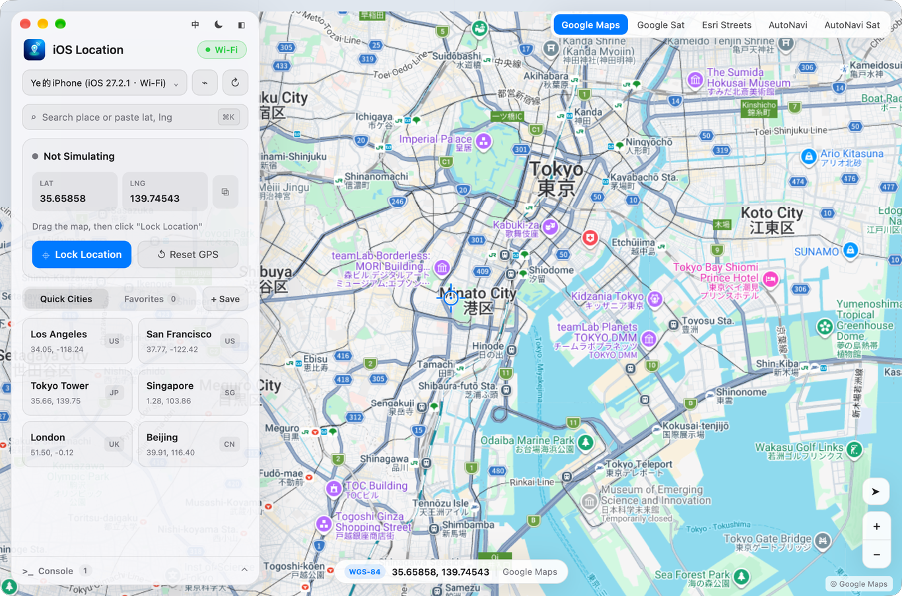

# iOS Location (GPUI)

<p align="center">
  
</p>

<p align="center">
  基于 Rust + <a href="https://gpui.rs">Zed GPUI</a>（纯原生 Metal GPU 渲染，<b>零 WebView / 零 Electron</b>）实现的 macOS iOS GPS 模拟定位桌面应用。<br/>
  支持 <b>iOS 17+ / 27+ 纯 Wi-Fi 无线定位模拟</b>（独立 RemotePairing 隧道、免 <code>sudo</code>）与 USB 有线 <code>xcrun devicectl</code> 模式。
</p>

## 应用截图

### 深色外观 · 简体中文 · 谷歌地图


### 浅色外观 · English · Google Maps


### 谷歌卫星图层 · 东京塔


## 核心特性

- **100% 原生 GPUI + Metal GPU 渲染（零 WebView）**：
  - 自研原生 Slippy 瓦片地图引擎，多线程异步拉取 + 内存/磁盘二级缓存 + Metal BGRA 纹理直绘，60/120 FPS 丝滑拖拽、点击选点与滚轮定焦缩放。
  - 原生 Apple HIG 悬浮毛玻璃面板、浅色 / 深色外观切换、原生 macOS 菜单栏及快捷键（`⌘K` 搜索、`⌘\` 收起面板）。
- **三通道设备发现与内置无线配对**：
  - 独立 **iOS 17+ / 27+ RemotePairing 隧道**（`pymobiledevice3 remote browse` / `--remotepairing`），彻底摆脱 macOS `usbmuxd` 空闲掉线。
  - 内置 **Wi-Fi 无线配对向导**（`pymobiledevice3 remote pair-host`），支持 6 位 PIN 码局域网直连配对。
  - 自动兼容 `usbmux` 与 Xcode `xcrun devicectl` 有线模式，单隧道平滑切换与真实 GPS 一键恢复。
- **多图源与 WGS-84 ↔ GCJ-02 自动纠偏**：
  - 内置 **谷歌地图 / 谷歌卫星**、**Esri 街道**、**高德地图**、**高德卫星（影像 + 路网标注双层叠加）**。
  - 自动完成中国大陆 GCJ-02 与真实 GPS WGS-84 坐标双向纠偏。
- **全栈中英双语 i18n（`zh-Hans` / `en`）**：
  - 标题栏一键切换 `EN` / `中`，实时同步全部界面、macOS 原生菜单栏、Google 地图瓦片语言及 Nominatim 地点搜索语言，并自动持久化偏好。
- **离线收藏与隐私安全**：
  - 收藏夹保存在 `~/Library/Application Support/iOS Location/favorites.json`，瓦片缓存保存在 `~/Library/Caches/iOS Location/tiles/`，零第三方云端依赖。

## 前置依赖

- macOS 13.0+（Apple Silicon / Intel）
- Rust 1.85+（项目使用 Rust 2024 Edition + `gpui 0.2.2`）
- [`pymobiledevice3`](https://github.com/doronz88/pymobiledevice3)：`uv tool install pymobiledevice3`
- iPhone 已开启「开发者模式」（无线模式需与 Mac 处于同一 Wi-Fi，可在应用内点击配对图标完成无线配对）

## 开发、测试与打包

```bash
# 运行单元测试
cargo test

# 本地运行（Debug）
cargo run

# 打包为 macOS 原生 .app 与 .dmg 安装包（自动生成 AppIcon.icns 并完成本地签名）
./scripts/bundle_macos.sh
```

> 历史 Go / MyGo WebView 版本已保留在 Git Tag `v0.1.0-mygo`。
