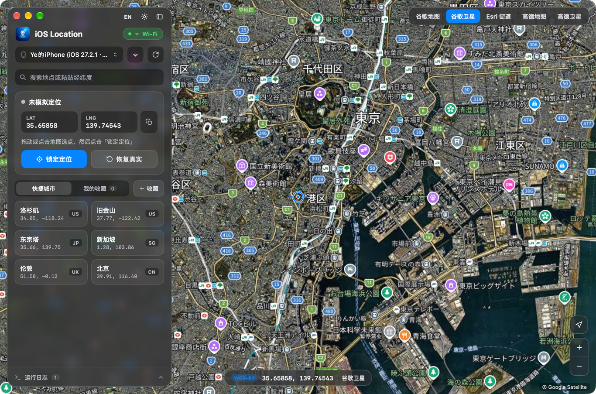

# iOS Location (MyGo Native GPU UI)

<p align="center">
  
</p>

<p align="center">
  基于纯 Go（<code>CGO_ENABLED=0</code>）+ <a href="https://github.com/egoist/mygo">MyGo 原生 GPU UI</a>（<code>mygo/ui</code> + <code>plugins/glass</code> Liquid Glass，<b>零 WebView / 零 HTML / 零 JS</b>）实现的 macOS iOS GPS 模拟定位桌面应用。<br/>
  支持 <b>iOS 17+ / 27+ 纯 Wi-Fi 无线定位模拟</b>（独立 RemotePairing 隧道、免 <code>sudo</code>）与 USB 有线 <code>xcrun devicectl</code> 模式。
</p>

## 应用截图

### 深色外观 · Liquid Glass · 简体中文 · 谷歌地图


### 浅色外观 · Liquid Glass · English · Google Maps


### 谷歌卫星图层 · 东京塔


## 核心特性

- **100% 纯 Go 原生 GPU 渲染（零 WebView）**：
  - 使用 `github.com/egoist/mygo/ui` 直接通过 macOS Metal GPU 绘制全部界面，配合 `plugins/glass` 原生 Liquid Glass 折射磨砂着色器，无 WebView 启动开销与内存负担。
  - 自研 Go 并发 Slippy 瓦片地图引擎（`tiles.go` + `coords.go`）：6 协程 LIFO 并发拉取、`ui.DecodeBitmap` GPU 纹理缓存 + 本地磁盘缓存（`~/Library/Caches/iOS Location/tiles/`），支持拖拽平移、点击选点、滚轮定焦缩放以及 MacBook 触控板双指捏合缩放（`ui.InputZoom`）。
- **三通道设备发现与内置无线配对**：
  - 独立 **iOS 17+ / 27+ RemotePairing 隧道**（`pymobiledevice3 remote browse` / `--remotepairing`），彻底摆脱 macOS `usbmuxd` 空闲掉线。
  - 内置 **Wi-Fi 无线配对向导**（`pymobiledevice3 remote pair-host`），支持 6 位 PIN 码局域网直连配对。
  - 自动兼容 `usbmux` 与 Xcode `xcrun devicectl` 有线模式，单隧道防冲突冷却重试与真实 GPS 一键恢复。
- **多图源与 WGS-84 ↔ GCJ-02 自动纠偏**：
  - 内置 **谷歌地图 / 谷歌卫星**、**Esri 街道**、**高德地图**、**高德卫星（影像 + 路网标注双层叠加）**。
  - 自动完成中国大陆 GCJ-02 与真实 GPS WGS-84 坐标双向纠偏。
- **全栈中英双语 i18n（`zh-Hans` / `en`）**：
  - 基于 MyGo 原生 `locales/*.json` + `mygo generate` 类型安全词条，标题栏一键切换 `EN` / `中`，实时同步全部原生 UI、macOS 顶部菜单栏、Go 后端日志/状态、Google 地图瓦片语言及 Nominatim 地点搜索语言，并自动持久化语言偏好。
- **离线收藏与快捷键**：
  - 收藏夹保存在 `~/Library/Application Support/iOS Location/favorites.json`，支持 `⌘K` 聚焦搜索、`⌘\` 收起/展开控制面板查看全屏地图。

## 前置依赖

- macOS 13.0+（Apple Silicon / Intel）
- Go 1.27.3+（`GOTOOLCHAIN=auto` 会自动拉取，纯 Go `CGO_ENABLED=0`）
- [`pymobiledevice3`](https://github.com/doronz88/pymobiledevice3)：`uv tool install pymobiledevice3`
- iPhone 已开启「开发者模式」（无线模式需与 Mac 处于同一 Wi-Fi，可在应用内点击 Wi-Fi 配对图标完成无线配对）

## 开发、测试与打包

```bash
# 运行单元测试
CGO_ENABLED=0 go test -count=1 ./...

# 更新多语言类型安全访问器（修改 locales/*.json 后）
go run github.com/egoist/mygo/cmd/mygo@v0.10.0 generate .

# 本地直接运行
go run .

# 打包 macOS 原生 .app 与 .dmg 安装包（自动生成 AppIcon.icns 与 .lproj 本地化包）
go run github.com/egoist/mygo/cmd/mygo@v0.10.0 build .
```

> 历史版本留档：WebView 版位于 Tag `v0.1.0-mygo`，Rust Zed GPUI 实验版位于 Tag `v0.2.0-rust-gpui`。
